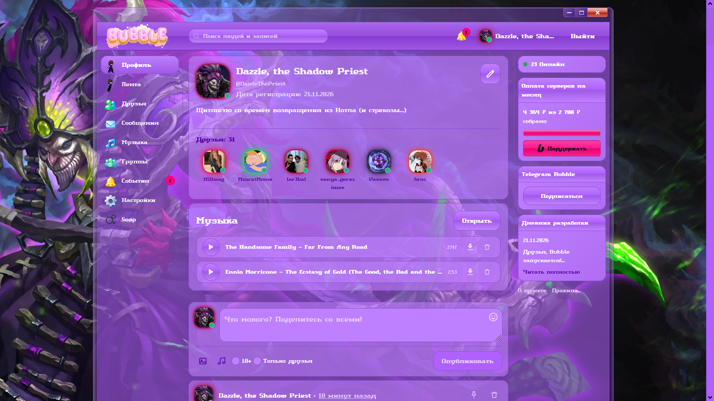
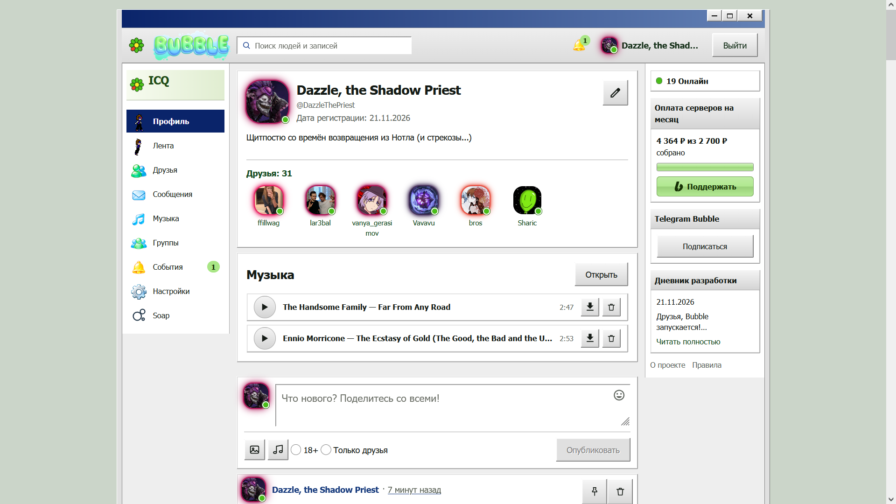

# 🫧 Soap

**Soap - расширенный кастомайзер для соцсети [Bubble](https://bubble-web.net/).**

Настраивай оформление через визуальный редактор и собственный CSS. Soap работает как пользовательский скрипт для Tampermonkey или Violentmonkey.

## Установка

1. Установи расширение [Tampermonkey](https://www.tampermonkey.net/), [Violentmonkey](https://violentmonkey.github.io/). 
2. Нажми **[Установить Soap](https://raw.githubusercontent.com/DazzleTheShadowPriest/Soap/main/Soap.user.js)**.
3. Подтверди установку в открывшемся окне Tampermonkey\Violentmonkey.
4. Открой или обнови [Bubble](https://bubble-web.net/).
5. В меню под «Настройки» выбери **"Soap"**.

## Возможности

- Более расширенная кастомизация по сравнению с ванилой.
- Пять слотов тем, импорт и экспорт файлов `.soap`.
- Тёмная тема.
- Неограниченный выбор цветов и более заметная прозрачность.
- Смена логтипа и иконок, поддерживается анимированый gif.
- Расположение фона.
- Более глубокая настройка через css.

## Скриншоты

**Результат кастомайзинга через Soap**

**Расширенная кастомизация через CSS.**
